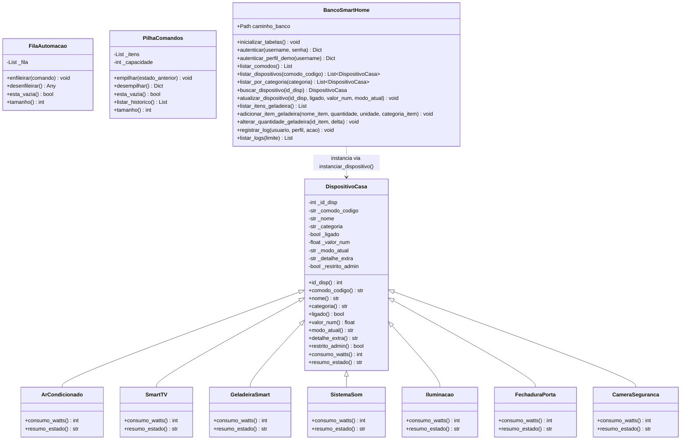
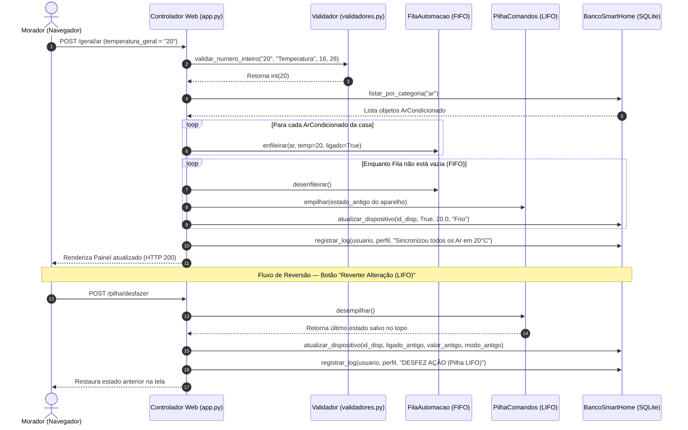
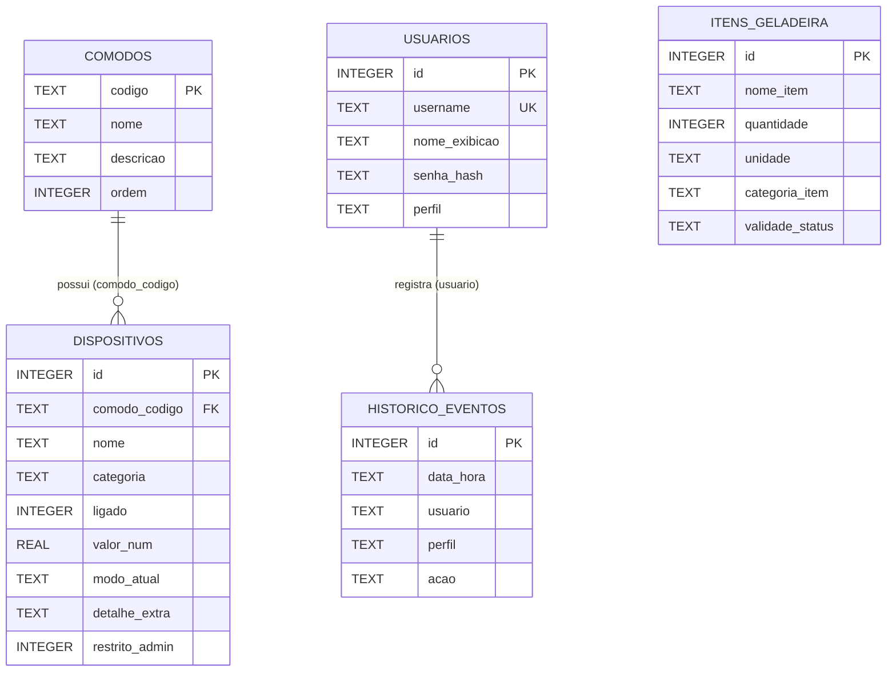

# Arquitetura e Diagramas UML — Smart Home 2050

Este documento apresenta o **Diagrama de Classes**, o **Diagrama de Sequência** e a **Modelagem do Banco de Dados (DER / SQLite3)** implementados no código do projeto.

---

## 1. Diagrama de Classes (UML)

Representa a hierarquia de Orientação a Objetos em `navbot/modelos.py`, as estruturas de dados em `navbot/estruturas.py` (`FilaAutomacao` e `PilhaComandos`) e a camada de persistência `BancoSmartHome` em `navbot/banco.py`.



---

## 2. Diagrama de Sequência (UML)

Representa o fluxo completo de execução quando o morador utiliza um comando no painel, passando pela validação (`navbot/validadores.py`), pela **Fila FIFO (`FilaAutomacao`)**, pela **Pilha LIFO (`PilhaComandos`)** e pela persistência no **SQLite (`BancoSmartHome`)**.



---

## 3. Banco de Dados Relacional (DER — SQLite3)

O banco de dados `smarthome2050.db` é gerenciado pela classe `BancoSmartHome` (`navbot/banco.py`) e possui **5 tabelas relacionais**:



### Estrutura DDL (SQL) das Tabelas no Código (`navbot/banco.py`):

```sql
CREATE TABLE IF NOT EXISTS usuarios (
    id INTEGER PRIMARY KEY AUTOINCREMENT,
    username TEXT UNIQUE NOT NULL,
    nome_exibicao TEXT NOT NULL,
    senha_hash TEXT NOT NULL,
    perfil TEXT NOT NULL
);

CREATE TABLE IF NOT EXISTS comodos (
    codigo TEXT PRIMARY KEY,
    nome TEXT NOT NULL,
    descricao TEXT NOT NULL,
    ordem INTEGER NOT NULL
);

CREATE TABLE IF NOT EXISTS dispositivos (
    id INTEGER PRIMARY KEY AUTOINCREMENT,
    comodo_codigo TEXT NOT NULL,
    nome TEXT NOT NULL,
    categoria TEXT NOT NULL,
    ligado INTEGER NOT NULL DEFAULT 1,
    valor_num REAL NOT NULL DEFAULT 20.0,
    modo_atual TEXT NOT NULL DEFAULT '',
    detalhe_extra TEXT NOT NULL DEFAULT '',
    restrito_admin INTEGER NOT NULL DEFAULT 0
);

CREATE TABLE IF NOT EXISTS itens_geladeira (
    id INTEGER PRIMARY KEY AUTOINCREMENT,
    nome_item TEXT NOT NULL,
    quantidade INTEGER NOT NULL,
    unidade TEXT NOT NULL,
    categoria_item TEXT NOT NULL,
    validade_status TEXT NOT NULL
);

CREATE TABLE IF NOT EXISTS historico_eventos (
    id INTEGER PRIMARY KEY AUTOINCREMENT,
    data_hora TEXT NOT NULL,
    usuario TEXT NOT NULL,
    perfil TEXT NOT NULL,
    acao TEXT NOT NULL
);
```
