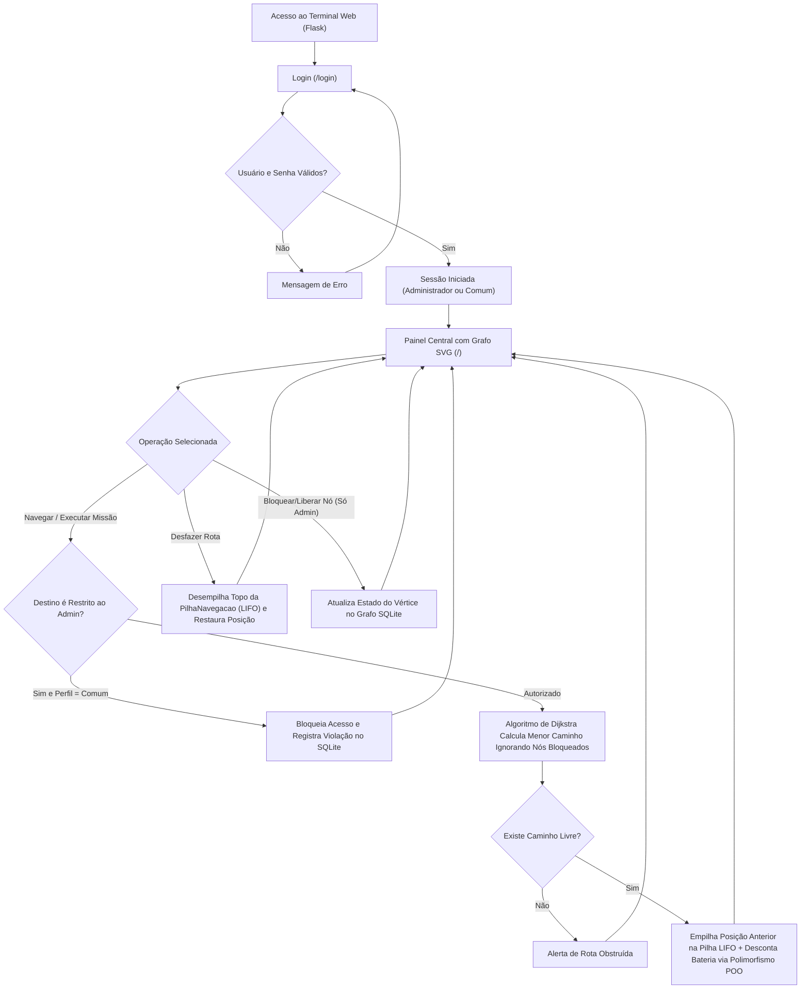

# Documentação Técnica — NavBot 2050

**Categoria:** INTELLIGENCE — 4º Semestre · Ciência da Computação (CDC)  
**Evento:** ExpoTech 2026.2 · Missão 2050: Smart Home & Tecnologias do Futuro  
**Stack:** Python + Flask + SQLite

---

## 1. Resumo do Sistema

O **NavBot 2050** é um simulador de navegação em grafo e gerenciador de missões para um robô doméstico autônomo (`Unidade R-2050`). Ele modela a planta da residência como um grafo ponderado onde cada cômodo é um vértice e cada corredor é uma aresta com peso equivalente à distância em metros, aplicando o **Algoritmo de Dijkstra** para encontrar rotas mínimas desviando de cômodos interditados.

---

## 2. Modelagem do Banco de Dados Relacional (SQLite)

O banco `robo2050.db` possui 5 tabelas implementadas em `navbot/banco.py`:
1. `usuarios`: credenciais (`admin` e `convidado`), hash de senha e perfil (`administrador` ou `comum`).
2. `comodos_grafo`: código do vértice (`BASE`, `SALA`, `COZ`, `Q1`, `Q2`, `LAB`, `GAR`, `JAR`), coordenadas `(pos_x, pos_y)`, flag `bloqueado` e flag `restrito_admin`.
3. `estado_robo`: posição atual no grafo (`no_atual`), percentual de bateria (`bateria_pct`), última rota calculada e distância acumulada em metros.
4. `missoes`: missões do robô com origem, destino, classe POO (`tipo`), prioridade (1 a 5), peso da carga em kg e rota executada.
5. `telemetria_logs`: histórico completo de auditoria, rotas calculadas e bloqueios de permissão.

---

## 3. Fluxograma da Aplicação

---

## 4. Estruturas de Dados e Orientação a Objetos

- **Grafo Ponderado + Dijkstra (`navbot/grafo.py`):** Representação por lista de adjacência e fila de prioridade mínima (`heapq`) para cálculo do menor caminho entre cômodos.
- **Fila de Prioridade (`FilaMissoes` em `navbot/estruturas.py`):** Ordena as missões pendentes da maior prioridade (P5) para a menor (P1).
- **Pilha LIFO (`PilhaNavegacao` em `navbot/estruturas.py`):** Armazena cada deslocamento do robô permitindo reverter passos em tempo constante $O(1)$.
- **POO (`navbot/modelos.py`):** Classe base `MissaoRobo` encapsulada com `@property` e subclasses `MissaoEntrega`, `MissaoLimpeza`, `MissaoPatrulha` e `MissaoEmergencia` sobrescrevendo polimorficamente `calcular_gasto_bateria(metros)`.
